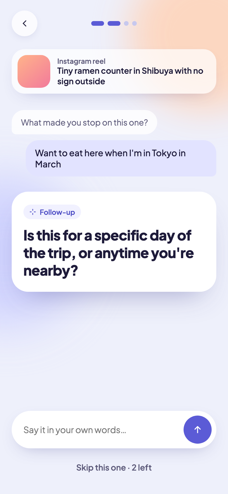
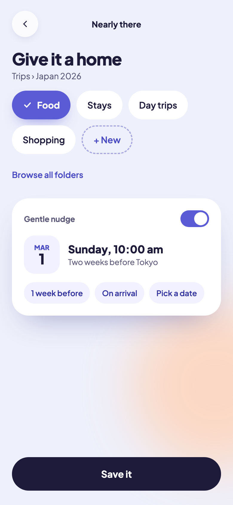
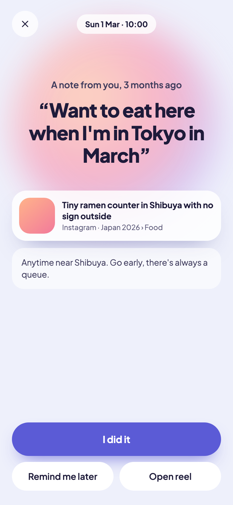

# Design — "Soft" direction

The visual direction chosen for Attention Span v1, out of five explored prototypes.
Calm pastel UI: lavender ground, periwinkle accent, peach glow, rounded cards and pill buttons.

| Understand | File & remind | Reminder moment |
|---|---|---|
|  |  |  |

1. **Understand** — the AI asks 2–4 short, adaptive questions about why you saved the post.
2. **File & remind** — you pick the folder yourself; the AI only *suggests* a reminder time from your own answer.
3. **Reminder moment** — when the reminder fires, your own words lead the screen, next to the saved post.

## Tokens

| Token | Value |
|---|---|
| Typeface | Plus Jakarta Sans (400–800) |
| Background | `#EEF0FB` |
| Surface | `#FFFFFF` |
| Ink | `#1E1B3A` |
| Muted text | `#5D5A7A` |
| Accent | `#5B5BD6` |
| Accent tint | `#F1F1FF` |
| Peach glow | `#FFD3B8` |
| Lilac glow | `#C9CCFF` |
| Radii | 22–28px cards, pills for buttons |

The app implements these in [`apps/mobile/src/theme.tsx`](../apps/mobile/src/theme.tsx).

## Files

- `prototypes/html/5-soft-*.html` — standalone 390×844 mockups (open in a browser).
- `prototypes/screens/5-soft-*.png` — the same screens rendered at 2×.
